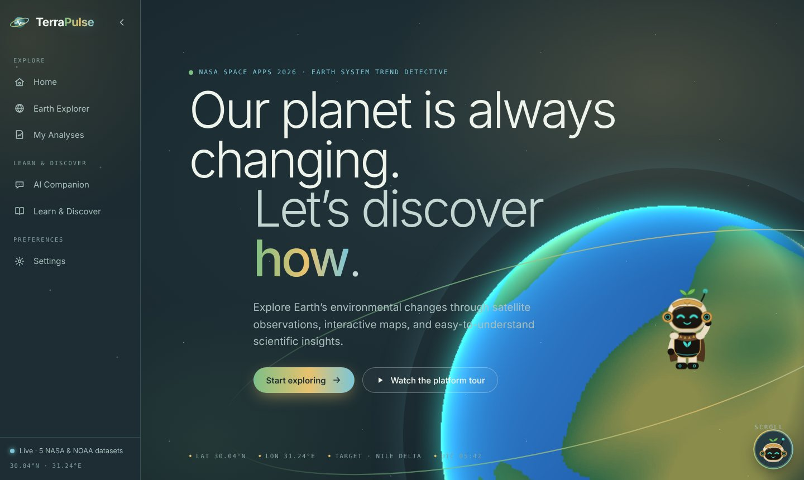
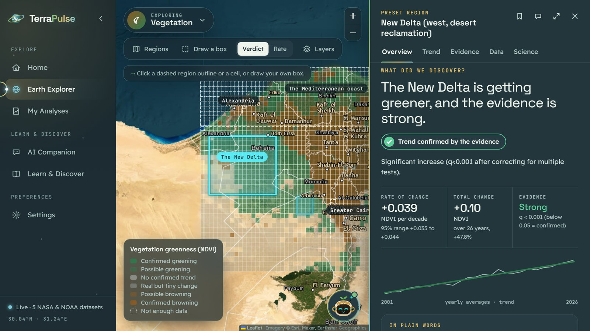
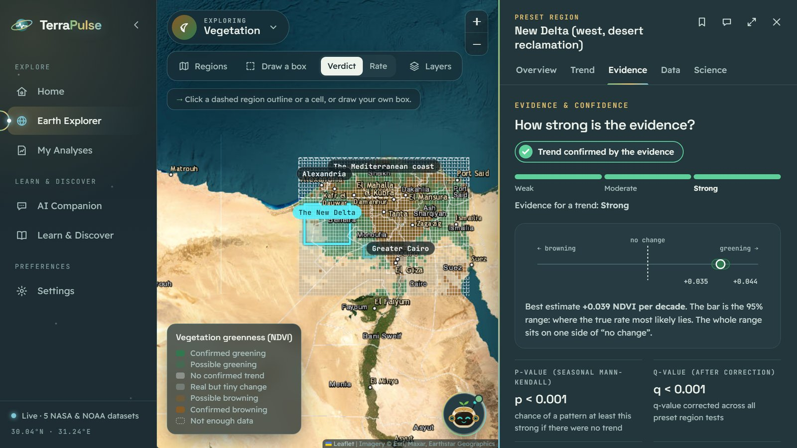
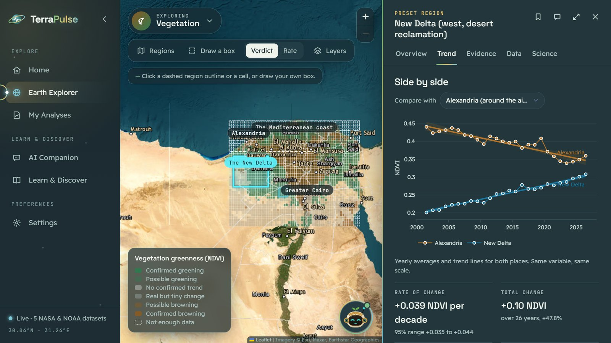
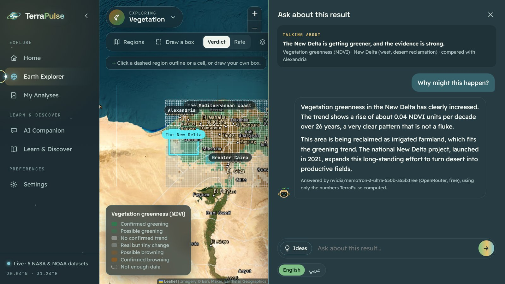
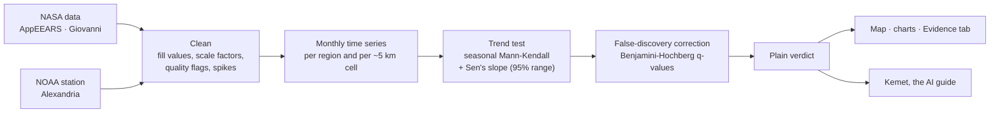

<div align="center">

# TerraPulse

### Evidence behind every change.

Turning NASA Earth observation data into clear, tested answers about how our environment is changing.

[](https://terrapulse-website.vercel.app)
[](https://youtu.be/OK9Jn-iAafY)
[](https://www.spaceappschallenge.org/2026/find-a-team/eam2ry-926/)




</div>

---

## Contents

- [The challenge](#the-challenge)
- [What TerraPulse does](#what-terrapulse-does)
- [Watch the demo](#watch-the-demo)
- [Screenshots](#screenshots)
- [How it works](#how-it-works)
- [NASA data](#nasa-data)
- [What we found](#what-we-found)
- [Run it locally](#run-it-locally)
- [Project structure](#project-structure)
- [Tech stack](#tech-stack)
- [Use of AI](#use-of-ai)
- [Team](#team)
- [Links](#links)

---

## The challenge

TerraPulse is Team **EAM²RY 926**'s answer to the NASA Space Apps Challenge 2026 challenge **[Be An Earth System Trend Detective!](https://www.spaceappschallenge.org/2026/challenges/earth-system-trend-detective/)**: build a tool that selects Earth science variables, shows how they change over time, and determines **what** is changing, **where**, **how much**, and whether the change is **statistically significant**.

NASA's Earth data is free, but turning it into a trustworthy answer usually takes statistics and programming skills. TerraPulse does that work and explains the answer in plain language, including when the data cannot yet support a conclusion.

## What TerraPulse does

| | |
|---|---|
| **Pick a variable** | Vegetation greenness, daytime land surface temperature, rainfall or nitrogen dioxide air pollution, each with a one-line plain definition. |
| **Pick a place** | A preset region, a single map cell of about 5 km, or a box you draw on the map, analysed live. |
| **See the change** | Monthly time series, yearly averages and the trend line, with two places side by side on one chart. |
| **Test it** | Seasonal Mann-Kendall test for significance and Sen's slope for the rate of change, with a 95% range. |
| **Get a clear verdict** | Confirmed trend, possible trend, real but too small to matter, no significant trend, or not enough data. |
| **Ask Kemet** | Our AI guide explains any result in English or Arabic, using only TerraPulse's computed numbers and documented facts, so it never invents causes. |

## Watch the demo

<div align="center">

[](https://youtu.be/OK9Jn-iAafY)

**[▶ Watch the 30-second demo on YouTube](https://youtu.be/OK9Jn-iAafY)** · **[Open the live website](https://terrapulse-website.vercel.app)**

</div>

The website also has a narrated walkthrough video on its home page and a short guided tour for first-time visitors.

## Screenshots

<table>
<tr>
<td width="50%"><br><sub><b>Earth Explorer.</b> Every map cell is coloured by its verdict. Selecting the New Delta gives a plain-language result: greening, with strong evidence.</sub></td>
<td width="50%"><br><sub><b>Evidence.</b> The p-value, the corrected q-value and the 95% range of the rate of change, each explained in one line.</sub></td>
</tr>
<tr>
<td width="50%"><br><sub><b>Side by side.</b> Two places on one chart: the New Delta greening while Alexandria browns.</sub></td>
<td width="50%"><br><sub><b>Kemet.</b> Ask "Why might this happen?" and Kemet answers from the computed numbers and documented facts, naming the model that wrote the answer.</sub></td>
</tr>
</table>

## How it works



1. **Get the data.** MODIS vegetation and land surface temperature through NASA AppEEARS; GPM IMERG rainfall and OMI nitrogen dioxide area averages through NASA Giovanni; a NOAA weather station record for Alexandria as a ground check.
2. **Clean it.** Remove fill values, apply scale factors and quality flags, drop physically impossible values and spikes, and average to monthly values. Months or cells with too many gaps are flagged. **Missing data is never invented.** The 1 km grids are averaged to about 5 km cells (2,520 cells over the Nile Delta).
3. **Handle a known sensor problem.** NASA's Terra satellite stopped correcting its orbit in 2020 and now passes earlier in the day, so its daytime temperatures read cooler each year. To avoid a false cooling trend, land surface temperature is analysed only until December 2021.
4. **Test for a trend.** The seasonal Mann-Kendall test compares January with January, February with February and so on, so the seasonal cycle cannot pose as a trend. Sen's slope gives the rate of change with a 95% range.
5. **Avoid chance findings.** When hundreds of cells are tested at once, about 5% would look significant by luck. Benjamini-Hochberg q-values correct for this.
6. **Give a plain verdict.** Records shorter than 10 years are reported as *not enough data*, and significant changes smaller than the instrument's uncertainty are labelled *real but tiny*.
7. **Check the method.** On simulated data with planted trends, TerraPulse found **28 of 28** planted trend cells, with 1 false alarm in 89 no-trend cells. On real data, the Alexandria weather station and the MODIS land surface temperature agree on warming.

## NASA data

| Variable | Dataset | Access | Record used |
|---|---|---|---|
| Vegetation greenness (NDVI) | [MODIS Terra MOD13A3 v061](https://doi.org/10.5067/MODIS/MOD13A3.061), monthly, 1 km | [AppEEARS](https://appeears.earthdatacloud.nasa.gov/) | Jan 2001 – Oct 2026 |
| Daytime land surface temperature | [MODIS Terra MOD11A2 v061](https://doi.org/10.5067/MODIS/MOD11A2.061), 8-day, 1 km | [AppEEARS](https://appeears.earthdatacloud.nasa.gov/) | Jan 2001 – Dec 2021 |
| Rainfall | [GPM IMERG Final monthly v07](https://doi.org/10.5067/GPM/IMERG/3B-MONTH/07) | [Giovanni](https://giovanni.gsfc.nasa.gov/) | Jan 1998 – Sep 2025 |
| Nitrogen dioxide (air pollution) | [Aura OMI OMNO2d v004](https://doi.org/10.5067/AURA/OMI/DATA3407) | [Giovanni](https://giovanni.gsfc.nasa.gov/) | Oct 2004 – Oct 2026 |
| Air temperature (ground check) | NOAA GHCN-Daily, Alexandria International (EGM00062318) | [NOAA Climate Data Online](https://www.ncei.noaa.gov/cdo-web/) | Jan 2000 – Jul 2023 |

Regions: the whole Nile Delta, the New Delta (western desert reclamation), Greater Cairo, the Mediterranean coast, Alexandria, and the Central Amazon around Manaus for a rainfall comparison.

## What we found

| Place | Variable | Result |
|---|---|---|
| New Delta | Vegetation (NDVI) | **Greening**, about +0.039 NDVI per decade since 2001 (p < 0.001) |
| Alexandria | Vegetation (NDVI) | **Browning**, about -0.038 NDVI per decade |
| Whole Nile Delta | Land surface temperature | **Warming**, about 0.40 °C per decade, 2001–2021 |
| Alexandria | Station air temperature | **Warming**, about 0.60 °C per decade, 2000–2023 |
| Greater Cairo | Nitrogen dioxide | **Rising**, about +0.89 × 10¹⁵ molecules/cm² per decade, 2004–2026 |
| Nile Delta, Mediterranean coast, Central Amazon | Rainfall | **No significant trend**, 1998–2025 |

"No trend" is a finding too: TerraPulse reports it as clearly as a trend.

## Run it locally

You need Python 3.12.

```bash
git clone https://github.com/ramaabdelgadir/terrapulse-web.git
cd terrapulse-web
pip install -r requirements.txt uvicorn
uvicorn index:app --reload
```

Then open http://localhost:8000.

To turn on Kemet, create a file named `.env` in the project folder with your [OpenRouter](https://openrouter.ai/) key:

```
OPENROUTER_API_KEY=your-key-here
```

Without a key, the site still works and Kemet gives a short built-in explanation instead.

**Deploying on Vercel:** import this repository in Vercel, add `OPENROUTER_API_KEY` under *Settings → Environment Variables*, and deploy. `index.py` and `vercel.json` are already set up.

## Project structure

```
terrapulse-web/
├── index.py              Entry point for Vercel and uvicorn
├── vercel.json           Vercel settings
├── config.py             Datasets, regions and statistical settings
├── trend_stats.py        Seasonal Mann-Kendall, Sen's slope, false-discovery correction, verdicts
├── app/
│   ├── server.py         FastAPI routes
│   ├── service.py        Loads results and runs live analysis for drawn boxes
│   ├── explainer.py      Kemet: prompts, model calls and fallback answers
│   └── static/           Website: HTML, CSS, JavaScript, walkthrough video
├── data/
│   ├── clean/            Cleaned monthly data and the cleaning report
│   └── results/          Trend results per region and per map cell
├── figures/              Validation figure
└── docs/images/          Screenshots for this README
```

This repository holds the website and the processed results it displays.

## Tech stack

| Area | Tools |
|---|---|
| Data and statistics | Python, pandas, xarray, NumPy, SciPy, netCDF4, pymannkendall |
| Server | FastAPI, Uvicorn |
| Website | JavaScript, Leaflet, Leaflet.draw, Plotly.js, Esri World Imagery base map |
| AI guide | NVIDIA Nemotron models through OpenRouter |
| Hosting | Vercel, GitHub |

## Use of AI

In line with the NASA Space Apps rules on AI use:

- **Kemet**, the in-app guide, uses NVIDIA Nemotron language models through OpenRouter. It sees only the statistics TerraPulse computed and a short list of documented facts about each place, and every answer names the model that wrote it.
- **Code and documentation:** parts of the code and this README were written with the help of an AI coding assistant and reviewed by the team.
- **Demo video:** the voice-over is AI-generated (Kokoro text-to-speech); the script was written by our team. The video shows a visible "Narration: AI-generated voice" label.
- **Kemet illustration:** created with AI assistance.
- **Data:** all data are real NASA and NOAA observations. No data were generated by AI.

## Team

**Team EAM²RY 926** · NASA Space Apps Cairo 2026 · [Team page](https://www.spaceappschallenge.org/2026/find-a-team/eam2ry-926/)

| Name | Role |
|---|---|
| Alia Abdalla Elnour | Variable selection and environmental context |
| Maab Obada Yousif | Variable selection and environmental context |
| Enas Yosry Mohamed | Variable selection and environmental context |
| Mennatallah Mahmoud Abdullah | Data engineering and trend analysis |
| Rama Abdelgadir Imam | AI engineering |
| Mawa Obada Yousif | Visualization and presentation of results |

## Links

- **Live website:** https://terrapulse-website.vercel.app
- **Demo video:** https://youtu.be/OK9Jn-iAafY
- **Team page:** https://www.spaceappschallenge.org/2026/find-a-team/eam2ry-926/
- **Challenge:** https://www.spaceappschallenge.org/2026/challenges/earth-system-trend-detective/
- **Proposal:** https://drive.google.com/drive/folders/1bQNF9n4wwbVGMzTCTtdOyDa3KQAfNKd6?usp=sharing

---

<sub>Built for the NASA Space Apps Challenge 2026. NASA does not endorse any non-U.S. Government entity and is not responsible for information contained on non-U.S. Government websites. Data courtesy of NASA Earthdata and NOAA NCEI. Base map imagery © Esri, Maxar, Earthstar Geographics.</sub>
